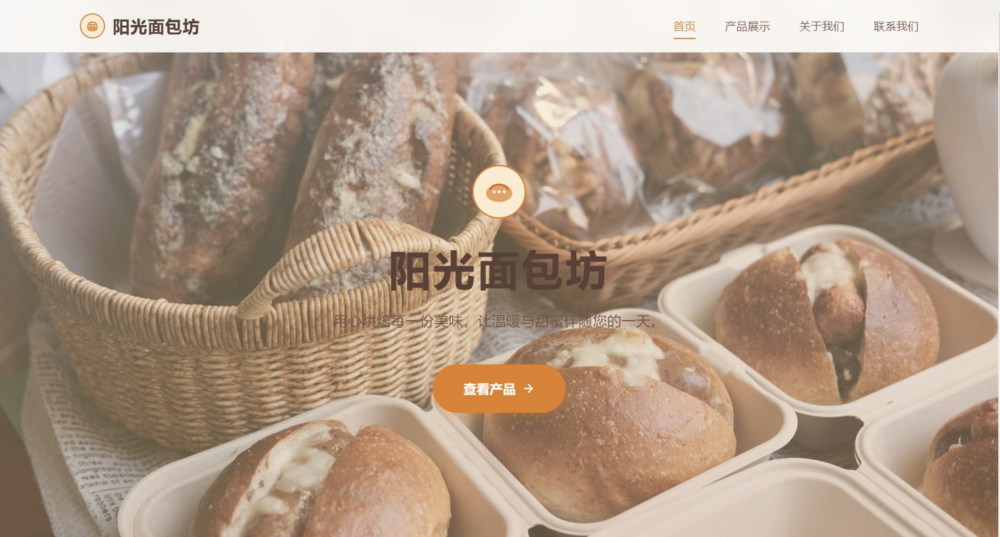

# 阳光面包坊 · 手作烘焙品牌官网

> 用心烘焙每一份美味，让温暖与甜蜜伴随您的一天。

**暖橙与奶油白构成的手作烘焙品牌网站**  
毕业设计作品 · 使用 Claude Code 辅助开发

[](https://developer.mozilla.org/zh-CN/docs/Web/HTML)
[](https://developer.mozilla.org/zh-CN/docs/Web/CSS)
[](https://developer.mozilla.org/zh-CN/docs/Web/JavaScript)
[](https://claude.com/claude-code)
[](#开发说明)

**[在线预览](https://morningluu.github.io/sunshine-bakery-website/)** · **[源码仓库](https://github.com/morningluu/sunshine-bakery-website)**



---

## 项目简介

「阳光面包坊」是一套面向社区手作烘焙品牌的官网。网站以“每天清晨，新鲜出炉”为叙事线索，把**品牌故事、特色产品、完整产品目录、门店联系**组织成温暖、明亮的浏览体验。

视觉上使用暖橙、奶油白与浅棕，搭配大面积面包摄影和圆润卡片。首屏以整幅烘焙场景建立嗅觉联想，产品页则通过分类筛选、横向产品轮播与购物车，让静态页面具备可操作的“选购感”。

## 页面与功能

| 页面 | 文件 | 主要内容 |
| --- | --- | --- |
| 首页 | `index.html` | 全屏烘焙主视觉、三款特色产品、展开式产品详情、品牌简介 |
| 产品展示 | `products.html` | 产品轮播、四类筛选（蛋糕 / 面包 / 甜点 / 饼干）、12 款商品、购物车 |
| 关于我们 | `about.html` | 品牌故事、团队介绍、烘焙理念、发展历程 |
| 联系我们 | `contact.html` | 地址、电话、邮箱、营业时间、留言表单与校验 |

### 核心交互

- **首页产品展开**：点击“查看详情”可在卡片内展开规格、原料与食用建议，再次点击收起。
- **产品分类筛选**：产品页按蛋糕、面包、甜点、饼干筛选，切换时更新商品网格。
- **产品轮播**：精选产品支持自动播放、前后切换和圆点跳转。
- **购物车本地持久化**：使用 `localStorage` 保存购物车，支持加购、数量增减、删除、清空、合计和下单 Toast 提示。
- **表单校验**：联系页校验姓名、电话、邮箱与留言内容，错误信息就地反馈，成功后显示提示。
- **滚动体验**：导航随滚动改变背景，内容块进入视口时淡入上浮，并提供回到顶部按钮。
- **响应式**：5 组媒体查询，移动端使用折叠菜单与单列卡片。

## 设计说明

- **色彩**：`#E67E22` 暖橙作为主色，`#FDFBF7` 奶油白作为底色，`#5D4037` 深棕承担正文。
- **影像**：以可颂、芝士蛋糕、吐司等烘焙特写作为主视觉，强调“刚刚出炉”的温度感。
- **形态**：大圆角、柔和投影、胶囊按钮与手写感英文标签，降低商业距离感。
- **版式**：首屏全幅影像 + 居中品牌名，产品区采用三列卡片与横向轮播，关于页使用时间线组织品牌历程。
- **动效**：`float`、`cartBounce`、`cartItemIn` 与滚动显现，节奏轻快、偏生活化。
- **内容**：产品描述包含规格、原料、食用建议，便于在答辩中讲解“内容结构化”的设计思路。

## 技术栈

- **HTML5**：四个页面共享导航与页脚，产品信息以内联结构组织。
- **CSS3**：CSS 变量、Flexbox / Grid、媒体查询、关键帧动画、渐变与阴影。
- **JavaScript**：轮播、分类筛选、卡片展开、购物车 CRUD、表单校验、Toast、滚动监听。
- **零依赖**：不引入前端框架，直接运行。

## 目录结构

```text
sunshine-bakery-website/
├── index.html
├── products.html
├── about.html
├── contact.html
├── css/
│   └── style.css           # 设计系统、页面样式与响应式规则
├── js/
│   └── main.js             # 轮播、筛选、购物车、表单等交互
├── images/                 # 面包、蛋糕、门店与团队图片
├── preview.jpg
└── README.md
```

## 本地运行

```bash
# 在项目根目录执行
python -m http.server 8000
```

访问 <http://localhost:8000>。也可直接打开 `index.html`，但推荐使用本地服务器。

## 开发说明

- **项目性质**：毕业设计 / 烘焙品牌静态网站设计
- **开发方式**：使用 **Claude Code** 辅助完成页面结构、样式与交互实现，由作者完成品牌内容、视觉方向与最终调整
- **设计关键词**：温暖、手作、社区感、食物摄影、轻盈动效
- **浏览器支持**：Chrome、Edge、Firefox、Safari 等现代浏览器

## 演示内容声明

页面中的“阳光面包坊”品牌、地址、电话、邮箱、产品价格与营业时间均为**毕业设计演示信息**，不对应真实门店或商业活动。图片素材仅用于学习与作品展示，版权归原作者所有；如有侵权请联系删除。

## 作者

[@morningluu](https://github.com/morningluu)
